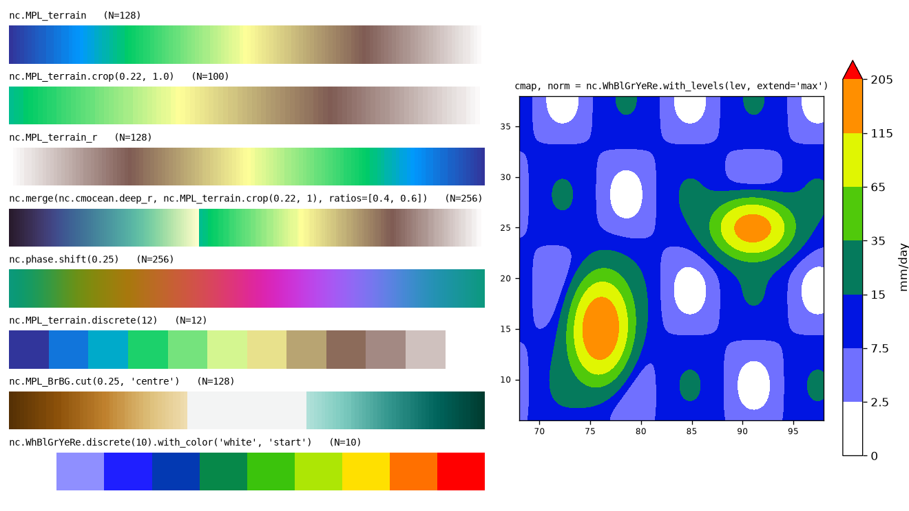

# nitincolors

Nitin's colormap library for Python: **983 scientific colour tables** from 11
collections (NCAR NCL, cmocean, ColorBrewer, Crameri, CET, CMasher,
CARTOColors, CarbonPlan, SciVisColor, cubehelix, Tableau). Each one comes
with tools to merge, crop, shift, discretise and level it for Matplotlib,
cartopy and xarray plots.



**Browse every colormap with a live preview: https://lohannitin.github.io/nitincolors/**

## Install

```bash
pip install nitincolors
```

Latest development version: `pip install git+https://github.com/Lohannitin/nitincolors.git`

Requires Python ≥ 3.9, Matplotlib ≥ 3.6 and NumPy.

## Quick start

```python
import nitincolors as nc
import matplotlib.pyplot as plt

nc.MPL_terrain                 # any map by name (attribute access)
nc.MPL_terrain_r               # reversed: add _r
nc.cmocean.deep                # explicit collection access
nc.get("GMT_topo")             # by string, e.g. in loops
nc.get("viridis")              # Matplotlib built-ins become nitincolors maps too

plt.pcolormesh(lon, lat, z, cmap=nc.MPL_terrain)
plt.pcolormesh(lon, lat, z, cmap="MPL_terrain")   # string works after first use
```

To use **string names** without touching the attribute first, call
`nc.register_all()` once at the top of a script.

## Methods

Every method returns a **new** map, so the bundled tables are never changed.

| Task | Code |
|---|---|
| Crop by fraction | `nc.MPL_terrain.crop(0.22, 1.0)` |
| Crop by index | `nc.GMT_topo[40:200]` |
| Merge maps | `nc.merge("cmocean_deep_r", "MPL_terrain", ratios=[0.4, 0.6], n=256)` |
| Merge (shorthand) | `nc.GMT_ocean + nc.MPL_terrain` or `cm1.merge(cm2, cm3)` |
| Trim ends while merging | `nc.merge(a, b, trim=0.1)` or `trim=[0.0, 0.2]` |
| N discrete colours | `nc.MPL_terrain.discrete(12)` |
| Smooth resample | `nc.cartocolors.fall.interpolate(256)` |
| Rotate (circular maps) | `nc.phase.shift(0.25)` |
| Widen / remove neutral centre | `nc.MPL_BrBG.cut(0.25, "centre")`, `.cut(-0.2, "centre")` |
| Cut one end | `.cut(0.2, "left")`, `.cut(0.2, "right")` |
| Reverse | `.reversed()` or `nc.<name>_r` |
| Lighten / darken | `.lighten(0.3)`, `.darken(0.2)` |
| Paint first / last / centre bins | `.with_color("white", at="start", n=1)` |
| Uneven contour levels | `cmap, norm = nc.WhBlGrYeRe.with_levels(lev, extend="max")` |
| Custom map from colours | `nc.from_list(["white", "#9ecae1", "navy"], n=256, name="rain")` |
| Load your own .rgb | `nc.from_file("my.rgb")` or `nc.add_dir("~/my_cmaps")` |
| Save | `.save("mymap.rgb")` (NCL format) or `.save("mymap.txt")` (hex) |
| Export values | `.rgb`, `.to_hex()`, `.to_rgb255()` |
| Register a string name | `.register("my_name")` |
| Preview | `.show()`, `nc.show("MPL_terrain", "GMT_topo")` |

### Rainfall-style uneven levels

```python
lev = [0, 2.5, 7.5, 15, 35, 65, 115, 205]          # mm/day
cmap, norm = nc.WhBlGrYeRe.with_levels(lev, extend="max")
cf = ax.contourf(lon, lat, rain, levels=lev, cmap=cmap, norm=norm, extend="max")
fig.colorbar(cf, ticks=lev)
```

The colours are spread evenly over the whole map, one per bin, plus one more
for each extended end.

## Finding maps

```python
nc.collections()                 # 11 collection names
nc.list_cmaps("ncar_ncl")        # names in one collection
nc.search("terrain")             # ['MPL_terrain']
nc.search("GMT_*")               # wildcards
nc.info("MPL_terrain")           # name, collection, N, source file
nc.show_collection("cmocean")    # preview strip of a whole collection
nc.show_all(save_dir="previews") # one PNG per collection
```

Browse them all, preview edits and copy the code at
<https://lohannitin.github.io/nitincolors/>. Static previews of every collection are in
[`gallery/`](https://github.com/Lohannitin/nitincolors/tree/main/gallery). After adding
colour tables, rebuild the site with `python docs/build_site.py`.

## Name rules

* A name that Matplotlib already uses (`rainbow`, `copper`, `ocean`, `prism`,
  `gray`, `cividis`, `berlin`, `managua`, `vanimo`) still gives **this
  library's** table through `nc.<name>`. As a string it is registered as
  `"nc.<name>"`, so Matplotlib's own `"rainbow"` is left untouched.
* `fall` exists in two collections: `nc.fall` is CMasher's 256-colour map and
  `nc.cartocolors.fall` is the 7-colour CARTOColors palette (string:
  `"cartocolors.fall"`).
* File names starting with a digit get an `N` prefix, and `-`/`+` become `_`.

## Fixes over the original `colormaps` package

nitincolors started from Pratiman Patel's
[`colormaps`](https://github.com/pratiman-91/colormaps) (v0.5.0). Changes:

1. **Missing maps restored.** The 93 NCL tables `MPL_*`, `cmocean_*` and
   `CBR_*` were deleted upstream in Sept 2021, but the website still listed
   `MPL_terrain`, `MPL_gist_earth`, `MPL_ocean`, `MPL_BrBG` and
   `cmocean_deep`. All 896 entries on the original website now resolve, and
   a test checks this.
2. **Wrong map for clashing names.** `colormaps.rainbow`, `.copper`, `.prism`,
   `.ocean`, `.gray` and `.cividis` returned Matplotlib's map instead of the
   collection's table. Fixed.
3. **`shift()`** always returned 50 colours and cropped instead of rotating.
   It now rotates and keeps N.
4. **`cut()`**: `cut(0.001, 'right')` returned an empty map (N = 0), and on
   odd-length maps every cut silently dropped the last colour. Both fixed.
5. **`discrete(N)`** could not return all N colours (it capped at N−1).
6. NCL `-1` placeholder rows in `default` and `hlu_default` were read as red.
   They are now white (background) and black (foreground), as in NCL.
7. The package stays a real Python module (PEP 562 attribute lookup instead
   of replacing itself in `sys.modules`). `nitincolors.__file__` works
   (`colormaps.__file__` raised `AttributeError`), and `help(nitincolors)`
   documents the package rather than an internal object.
8. A user `.rgb` directory can be added at runtime with `nc.add_dir()`.
   Setting the environment variable `NITINCOLORS_DIR` (or `CMAP_DIR`) also
   still works.

## Tests

```bash
pip install -e ".[test]" && pytest
```

The suite has 1,005 tests: every map and its reverse, every website entry,
and every method.

## Credits

See [CREDITS.md](https://github.com/Lohannitin/nitincolors/blob/main/CREDITS.md). The colour tables belong to their original
authors. Please credit the source collection when publishing a figure.
